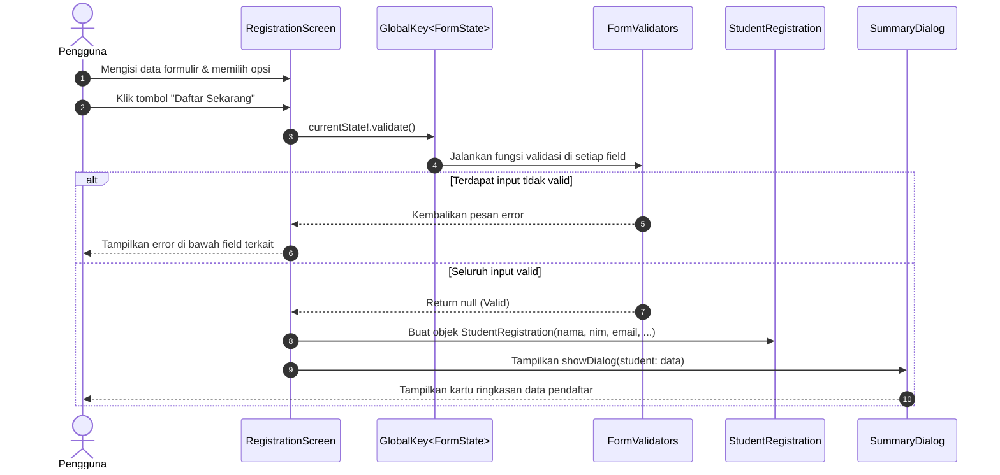

# 🏛️ Architecture & Technical Specification
## Aplikasi Formulir Registrasi Mahasiswa Baru (EduPortal)

---

### 1. Prinsip Desain & Pola Arsitektur
Arsitektur aplikasi dirancang menggunakan pendekatan **Layered Modular Architecture** yang memisahkan antara:
* **Presentation Layer**: Widget UI yang reusable, screen utama, dan pop-up dialog.
* **Domain / Data Layer**: Model data representasi entitas mahasiswa.
* **Core / Utility Layer**: Fungsi validasi mandiri (*pure functions*) dan konstanta tema yang terpusat.

Pendekatan ini menjamin prinsip **Single Responsibility Principle (SRP)** dan mencegah *God Widget* / *Spaghetti Code*.

---

### 2. Struktur Direktori Proyek

```text
lib/
│
├── core/
│   ├── constants/
│   │   ├── app_colors.dart            # Definisi palette warna terpusat
│   │   └── app_styles.dart            # Typography, border radius, dimensi & spacing
│   └── utils/
│       └── form_validators.dart       # Kumpulan fungsi validator form (Unit-testable)
│
├── models/
│   └── student_registration.dart      # Data model penampung data pendaftar
│
├── widgets/
│   ├── app_header.dart                # Widget header estetik dengan ikon toga
│   ├── custom_text_field.dart         # Widget input teks reusable dengan styling modern
│   ├── gender_selector.dart           # Widget seleksi radio button jenis kelamin
│   ├── hobby_selector.dart            # Widget multi-select checkbox hobi
│   ├── program_dropdown.dart          # Widget dropdown pemilihan program studi
│   └── registration_summary_dialog.dart # Modal dialog ringkasan pendaftaran
│
├── screens/
│   └── registration_screen.dart       # Form screen utama yang menggabungkan seluruh komponen
│
└── main.dart                          # Root app & inisialisasi MaterialApp
```

---

### 3. Diagram Alur Data & State



---

### 4. Peran dan Kontrak Komponen

#### 4.1 Core Utilities (`lib/core/utils/form_validators.dart`)
Berisi fungsi-fungsi murni (*pure functions*) tanpa dependensi ke widget, memudahkan pengujian:
* `validateRequired(String? value, String fieldName, {int minLength = 1})`
* `validateNIM(String? value)`: Memastikan numerik dan minimal 8 digit.
* `validateEmail(String? value)`: Memeriksa struktur RFC email.
* `validatePassword(String? value, {int minLength = 8})`
* `validateDropdown(String? value)`

#### 4.2 Data Model (`lib/models/student_registration.dart`)
```dart
class StudentRegistration {
  final String fullName;
  final String nim;
  final String email;
  final String password;
  final String gender;
  final List<String> hobbies;
  final String studyProgram;
  final bool agreedToTerms;

  StudentRegistration({
    required this.fullName,
    required this.nim,
    required this.email,
    required this.password,
    required this.gender,
    required this.hobbies,
    required this.studyProgram,
    required this.agreedToTerms,
  });
}
```

#### 4.3 Presentation Widgets
* **`CustomTextField`**: Mengenkapsulasi `TextFormField` dengan styling `filled: true`, `fillColor`, radius melengkung 16px, icon prefix, dan callback validator.
* **`GenderSelector`**: Merender pilihan gender Laki-laki & Perempuan secara horizontal atau card berdampingan dengan radio visual.
* **`HobbySelector`**: Mengelola status multi-select hobi (Membaca, Musik, Olahraga, Fotografi) secara reaktif.
* **`ProgramDropdown`**: Membungkus `DropdownButtonFormField` dengan dekorasi yang identik dengan field teks.
* **`RegistrationSummaryDialog`**: Dialog ringkasan yang menyajikan data pendaftaran secara rapi dan estetis.

