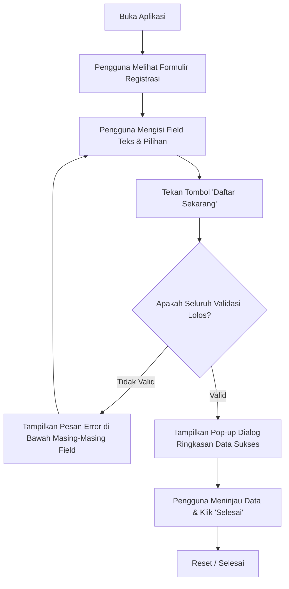

# 📄 Product Requirement Document (PRD)
## Aplikasi Formulir Registrasi Mahasiswa Baru (EduPortal)

---

### 1. Informasi Dokumen
* **Nama Proyek**: EduPortal - Formulir Elektronik Pendaftaran Mahasiswa Baru
* **Mata Kuliah**: Pemrograman Mobile (Semester 5)
* **Topik Praktikum**: Forms pada Flutter (Tugas Proyek Akhir - Slide 19)
* **Target Platform**: Flutter Mobile (Android / iOS) & Desktop/Web Responsive
* **Versi Dokumen**: v1.0.0
* **Status**: Approved for Implementation

---

### 2. Latar Belakang & Tujuan
#### 2.1 Latar Belakang
Proses penerimaan dan registrasi mahasiswa baru membutuhkan alur input data yang terstruktur, aman, dan mudah digunakan. Di era digital, formulir fisik mulai ditinggalkan dan digantikan oleh formulir elektronik berbasis mobile app.

#### 2.2 Tujuan Produk
Membangun aplikasi mobile Flutter yang menyediakan formulir registrasi mahasiswa yang interaktif, memiliki visual minimalis modern yang ramah pengguna, menerapkan sistem validasi data yang ketat pada setiap field sesuai panduan modul praktikum, dan menampilkan ringkasan data yang telah diisi dalam bentuk dialog interaktif.

---

### 3. Target Pengguna (User Persona)
* **Persona**: Calon Mahasiswa Baru / Mahasiswa Aktif.
* **Karakteristik**: Menginginkan antarmuka yang modern, bersih, intuitif, cepat diisi di perangkat smartphone, serta memberikan feedback yang jelas saat terjadi kesalahan pengisian formulir.

---

### 4. Lingkup Fitur (Feature Scope)

| ID Fitur | Nama Fitur | Deskripsi | Kategori |
| :--- | :--- | :--- | :--- |
| **FEAT-01** | Visual Header & Branding | Menampilkan ikon akademik toga dan judul formulir dengan gaya modern. | UI / Branding |
| **FEAT-02** | Input Data Pribadi & Akun | Input Nama Lengkap, NIM, Email, dan Password dengan kontrol interaktif. | Input Form |
| **FEAT-03** | Toggle Password Visibility | Ikon mata untuk menyembunyikan atau memperlihatkan karakter password. | UX / Security |
| **FEAT-04** | Pilihan Jenis Kelamin | Radio button pilihan eksklusif (Laki-laki / Perempuan). | Selection |
| **FEAT-05** | Pilihan Hobi | Checkbox pilihan majemuk (Membaca, Musik, Olahraga, Fotografi). | Selection |
| **FEAT-06** | Pemilihan Program Studi | Dropdown form field dengan daftar program studi resmi. | Selection |
| **FEAT-07** | Persetujuan Syarat & Ketentuan | Checkbox persetujuan wajib sebelum formulir dikirim. | Compliance |
| **FEAT-08** | Validasi Komprehensif Realtime/Submit | Pengecekan keabsahan setiap input dengan pesan error deskriptif. | Data Integrity |
| **FEAT-09** | Ringkasan Data Pendaftaran (Dialog) | Pop-up modal estetik yang menampilkan rekap seluruh data yang diisi. | Output / Feedback |

---

### 5. Aturan Validasi & Kriteria Penerimaan (Acceptance Criteria)

#### 5.1 Matriks Validasi Field

| No | Field | Tipe Input / Widget | Aturan Validasi | Pesan Error |
| :--- | :--- | :--- | :--- | :--- |
| 1 | **Nama Lengkap** | `TextFormField` (Text) | Tidak boleh kosong, minimal 3 karakter, tidak boleh hanya spasi. | *"Nama lengkap wajib diisi (minimal 3 karakter)"* |
| 2 | **NIM** | `TextFormField` (Number) | Hanya berisi angka numerik, minimal 8 digit karakter. | *"NIM wajib diisi berupa angka minimal 8 digit"* |
| 3 | **Email** | `TextFormField` (EmailAddress) | Format regex email standar (`^[a-zA-Z0-9._%+-]+@[a-zA-Z0-9.-]+\.[a-zA-Z]{2,}$`). | *"Format email tidak valid (contoh: nama@email.com)"* |
| 4 | **Password** | `TextFormField` (Password) | Minimal 8 karakter, wajib diisi. | *"Password wajib diisi minimal 8 karakter"* |
| 5 | **Jenis Kelamin** | `RadioListTile` | Wajib memilih salah satu opsi. | Tervalidasi default / pesan error seleksi |
| 6 | **Hobi** | `Checkbox` (Multi-select) | Pengguna wajib memilih minimal 1 hobi. | *"Pilih minimal salah satu hobi Anda"* |
| 7 | **Program Studi** | `DropdownButtonFormField` | Wajib memilih opsi selain `null`. | *"Program studi wajib dipilih"* |
| 8 | **Syarat & Ketentuan** | `Checkbox` | Wajib dalam status `true` (dicentang). | *"Anda harus menyetujui syarat & ketentuan"* |

---

### 6. Alur Pengguna (User Flow)

---

### 7. Non-Functional Requirements
1. **Responsiveness**: UI dapat beradaptasi pada berbagai ukuran layar Android & iOS tanpa *overflow error* (`SingleChildScrollView` + `SafeArea`).
2. **Accessibility**: Kontras warna memenuhi standar kenyamanan membaca (Dark green di atas soft grey/white).
3. **Usability**: Input field memiliki visual feedback (fokus border, hint text jelas, icon pendukung).

